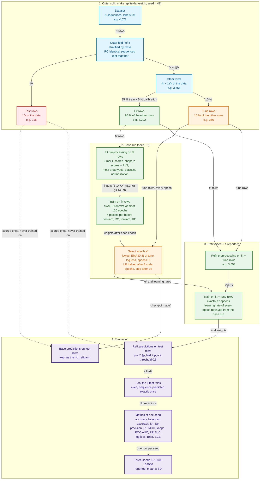

# MorphoNup

MorphoNup classifies 147-bp DNA sequences as **nucleosomal** or **linker** from the sequence and its DNA shape.
It is one convolutional network per cross-validation fold (no ensemble), 134,442 parameters.

This repository holds the model package (`morphonup/`), the notebooks, the run scripts, the documentation and the
12 benchmark datasets (as a zip archive in `dataset/`, unpacked as described in [section 3](#3-data)). Training writes
every model, prediction, table and figure to `results/`, which is created on the first run.

**Contents**
1. [Quick start](#1-quick-start)
2. [The model](#2-the-model)
3. [Data](#3-data)
4. [Evaluation protocol](#4-evaluation-protocol)
5. [Notebooks](#5-notebooks)
6. [Command-line scripts](#6-command-line-scripts)
7. [Results folder: every file](#7-results-folder-every-file)
8. [Figures](#8-figures)
9. [Analyses: architecture, modality, explainability](#9-analyses)
10. [Code: the package](#10-code-the-package)
11. [Verification](#11-verification)
12. [Environment, reproducibility, troubleshooting](#12-environment-reproducibility-troubleshooting)

---

## 1. Quick start

```bash
git clone https://github.com/normaneulin/MorphoNup.git
cd MorphoNup

# 1. unpack the datasets into ./data (section 3)
zip -s 0 dataset/MorphoNup_data.zip --out MorphoNup_data_joined.zip
unzip -q MorphoNup_data_joined.zip && rm MorphoNup_data_joined.zip

# 2. Python environment (Python 3.12; section 12)
conda create -n morphonup python=3.12 -y && conda activate morphonup
pip install -r requirements.txt           # NVIDIA GPU on Linux: pip install "tensorflow[and-cuda]==2.19.1" first

# 3. run
nvidia-smi                                # check that the GPU is free
jupyter lab notebooks/                    # or use the scripts in section 6
```

* Train one dataset: `notebooks/01_Train_MorphoNup.ipynb` → set `DATASET`, `K_FOLDS` (5 or 10), `SEEDS`,
  `RUN_MODE = "background"` → *Run all*. The job keeps running after you close the notebook.
* Look at all datasets together: `notebooks/02_Benchmark_All_Datasets.ipynb`.
* Analyses: notebooks `03` (architecture), `04` (modality), `05` (SHAP / explainability).

Every notebook starts with `RUN_MODE = "results_only"`, so opening a notebook and pressing *Run all* only shows
results and never starts a job by accident.

---

## 2. The model

### 2.1 Architecture diagram (interactive)

Follow a sequence from the raw inputs to the prediction. Every box shows the operation and its output tensor
(B = batch size); every arrow is labelled with the tensor it carries. Hover a box for its details (in renderers
that allow Mermaid tooltips, e.g. VS Code's Mermaid preview or mermaid.live; on GitHub the diagram renders without
tooltips). Colours: blue = sequence path, orange = shape path, green = motifs (sequence × shape), purple = head,
pink = physical adapter, teal = motif statistics, red = output. All numbers are taken from the built model
(`morphonup/network.py`, `config.SETTINGS`, `config.SHAPE`).

```mermaid
flowchart TD
    classDef seqPath fill:#e1f5fe,stroke:#0288d1,stroke-width:2px,color:#01579b;
    classDef physPath fill:#fff3e0,stroke:#f57c00,stroke-width:2px,color:#e65100;
    classDef dropPath fill:#f5f5f5,stroke:#9e9e9e,stroke-width:1px,color:#616161,stroke-dasharray:4 3;
    classDef motifPath fill:#e8f5e9,stroke:#388e3c,stroke-width:2px,color:#1b5e20;
    classDef trunkPath fill:#ede7f6,stroke:#512da8,stroke-width:2px,color:#311b92;
    classDef adaptPath fill:#fce4ec,stroke:#c2185b,stroke-width:2px,color:#880e4f;
    classDef statPath fill:#e0f2f1,stroke:#00796b,stroke-width:2px,color:#004d40;
    classDef outPath fill:#ffebee,stroke:#d32f2f,stroke-width:3px,color:#b71c1c;

    subgraph RAW ["0. Raw data (one record = one 147-bp sequence)"]
        RAW_SEQ["FASTA record<br/>nucleosomal_sequence_* → label 1<br/>linker_sequence_* → label 0<br/><b>147 bp, A/C/G/T</b>"]:::seqPath
        RAW_SHAPE["DNAshapeR, 14 files<br/>8 base-pair tracks × 147<br/>6 base-pair-step tracks × 146"]:::physPath
    end

    subgraph ENC ["1. Input encoding (statistics from fit rows only)"]
        IN_SEQ["One-hot sequence<br/><b>(B, 147, 4)</b><br/>A, C, G, T<br/>+ reverse-complement view"]:::seqPath
        IN_KMER["1–4-mer frequencies<br/>4 + 16 + 64 + 256<br/>z-scored<br/><b>(B, 340)</b>"]:::trunkPath
        TR14["14 tracks on base-pair centres<br/>bp tracks at positions 3–145<br/>step tracks averaged onto bp<br/><b>(B, 143, 14)</b>"]:::physPath
    end

    subgraph PREP ["2. Shape preprocessing (fitted on fit rows, both strands pooled)"]
        EXPL["MGW, Roll, EP<br/>z-score<br/><b>(B, 143, 3)</b>"]:::physPath
        PLSB["Opening, ProT, Stagger, Stretch,<br/>HelT, Rise, Slide → z-score →<br/>dyad-weighted PLS1, σ = 35 bp<br/>→ 6 scores, re-standardized<br/><b>(B, 143, 6)</b>"]:::physPath
        DROP["Buckle, Shear, Shift, Tilt<br/>antisymmetric under RC<br/>zero PLS loadings → not used"]:::dropPath
        IN_PHYS["Shape input<br/><b>(B, 143, 9)</b><br/>MGW, Roll, EP, PLS 0–5<br/>4 groups"]:::physPath
    end

    subgraph MOTIF ["3. Grouped joint motifs: 168 motifs, 12,396 parameters"]
        M7["k = 7 bp, 64 motifs<br/>PWM match × shape RBF<br/><b>(B, 141, 64)</b><br/>3,525 params"]:::motifPath
        M11["k = 11 bp, 48 motifs<br/>PWM match × shape RBF<br/><b>(B, 137, 48)</b><br/>3,413 params"]:::motifPath
        M15["k = 15 bp, 32 motifs<br/>PWM match × shape RBF<br/><b>(B, 133, 32)</b><br/>2,789 params"]:::motifPath
        M21["k = 21 bp, 24 motifs<br/>PWM match × shape RBF<br/><b>(B, 127, 24)</b><br/>2,669 params"]:::motifPath
    end

    subgraph HEAD ["4. Dyad pooling, composition and head: 116,033 parameters"]
        DP7["DyadPool k=7<br/>mean + max + 7 dyad bins<br/><b>(B, 576)</b> = 64 × 9"]:::motifPath
        DP11["DyadPool k=11<br/><b>(B, 432)</b> = 48 × 9"]:::motifPath
        DP15["DyadPool k=15<br/><b>(B, 288)</b> = 32 × 9"]:::motifPath
        DP21["DyadPool k=21<br/><b>(B, 216)</b> = 24 × 9"]:::motifPath
        COMP["Composition<br/>Dense(32, GELU)<br/><b>(B, 32)</b><br/>10,912 params"]:::trunkPath
        CAT["Concatenate<br/>576 + 432 + 288 + 216 + 32<br/><b>(B, 1,544)</b>"]:::trunkPath
        BN["BatchNorm → Dropout 0.5<br/><b>(B, 1,544)</b><br/>6,176 params (3,088 trainable)"]:::trunkPath
        EMB["Joint embedding<br/>Dense(64, GELU)<br/><b>(B, 64)</b><br/>98,880 params"]:::trunkPath
        Z0["Dropout 0.5 → Dense(1)<br/>base logit z<br/><b>(B, 1)</b><br/>65 params"]:::trunkPath
    end

    subgraph ADAPT ["5. Physical adapter: 4,046 parameters"]
        G0["MGW → Conv1D(4, k=5, GELU)<br/><b>(B, 143, 4)</b>"]:::physPath
        G1["Roll → Conv1D(4, k=5, GELU)<br/><b>(B, 143, 4)</b>"]:::physPath
        G2["EP → Conv1D(4, k=5, GELU)<br/><b>(B, 143, 4)</b>"]:::physPath
        G3["PLS 0–5 → Conv1D(4, k=5, GELU)<br/><b>(B, 143, 4)</b>"]:::physPath
        GCAT["Concatenate grouped convolutions<br/><b>(B, 143, 16)</b>"]:::adaptPath
        GPOOL["DyadPool<br/><b>(B, 144)</b> = 16 × 9"]:::adaptPath
        MOM["Moments: mean, SD per channel<br/><b>(B, 18)</b> = 9 × 2"]:::adaptPath
        GAB["Fixed Gabor energies<br/>61-bp quadrature filters<br/>periods 9.5, 10.2, 10.8, 11.5 bp<br/><b>(B, 72)</b> = 9 × 4 × 2"]:::adaptPath
        CTX["Physical context<br/>144 + 18 + 72<br/><b>(B, 234)</b>"]:::adaptPath
        CTXD["Dense(16, GELU) → Dropout 0.25<br/><b>(B, 16)</b><br/>3,760 params"]:::adaptPath
        ARIN["Concatenate shape context + embedding<br/>16 + 64<br/><b>(B, 80)</b>"]:::adaptPath
        D1["Zero-initialized Dense(1)<br/>correction δ₁<br/><b>(B, 1)</b>"]:::adaptPath
        ANCH["ConnectedAnchor<br/>passes z unchanged<br/><b>(B, 1)</b>"]:::adaptPath
        B1["Bounded correction<br/>z₁ = z + tanh(δ₁)<br/>penalty 0.02 · mean(tanh(δ₁)²)<br/><b>(B, 1)</b>"]:::adaptPath
    end

    subgraph STATS ["6. Motif statistics: 1,967 parameters"]
        WH["MotifStatistics (from one-hot)<br/>16 dimers + 64 trimers<br/>7 dyad bins + recurrence at 10, 11, 12 bp<br/><b>(B, 800)</b>"]:::statPath
        NORM["Normalization, fit-row mean and variance<br/><b>(B, 800)</b>"]:::statPath
        BYW["StatisticsByWord<br/>80 words × 10 descriptors<br/><b>(B, 80, 10)</b>"]:::statPath
        WENC["Shared Dense(10 → 4, GELU) → Dropout 0.25<br/><b>(B, 80, 4)</b>"]:::statPath
        FLAT["Flatten<br/><b>(B, 320)</b>"]:::statPath
        D2["Zero-initialized Dense(1)<br/>correction δ₂<br/><b>(B, 1)</b>"]:::statPath
        B2["Bounded correction<br/>z₂ = z₁ + tanh(δ₂)<br/>penalty 0.02 · mean(tanh(δ₂)²)<br/><b>(B, 1)</b>"]:::statPath
    end

    subgraph OUT ["7. Output: one network, 134,442 parameters (129,743 trainable)"]
        SIG["Sigmoid per view<br/>p_fwd = σ(z₂ forward), p_rc = σ(z₂ RC)<br/><b>(B, 1)</b> each"]:::outPath
        AVG["Strand average<br/>p = ½ (p_fwd + p_rc)<br/><b>(B,)</b>"]:::outPath
        PRED["Prediction<br/>nucleosome if p ≥ 0.5, else linker<br/>no post-hoc calibration"]:::outPath
    end

    RAW_SEQ -->|"147 bp"| IN_SEQ
    RAW_SEQ -->|"147 bp, both strands"| IN_KMER
    RAW_SHAPE -->|"147 + 146 values per track"| TR14
    TR14 -->|"(B, 143, 3)"| EXPL
    TR14 -->|"(B, 143, 7)"| PLSB
    TR14 -.->|"(B, 143, 4)"| DROP
    EXPL -->|"(B, 143, 3)"| IN_PHYS
    PLSB -->|"(B, 143, 6)"| IN_PHYS

    IN_SEQ -->|"(B, 147, 4)"| M7
    IN_SEQ -->|"(B, 147, 4)"| M11
    IN_SEQ -->|"(B, 147, 4)"| M15
    IN_SEQ -->|"(B, 147, 4)"| M21
    IN_PHYS -->|"(B, 143, 9)"| M7
    IN_PHYS -->|"(B, 143, 9)"| M11
    IN_PHYS -->|"(B, 143, 9)"| M15
    IN_PHYS -->|"(B, 143, 9)"| M21
    IN_SEQ -->|"(B, 147, 4)"| WH
    IN_KMER -->|"(B, 340)"| COMP

    M7 -->|"(B, 141, 64)"| DP7
    M11 -->|"(B, 137, 48)"| DP11
    M15 -->|"(B, 133, 32)"| DP15
    M21 -->|"(B, 127, 24)"| DP21
    DP7 -->|"(B, 576)"| CAT
    DP11 -->|"(B, 432)"| CAT
    DP15 -->|"(B, 288)"| CAT
    DP21 -->|"(B, 216)"| CAT
    COMP -->|"(B, 32)"| CAT
    CAT -->|"(B, 1,544)"| BN
    BN -->|"(B, 1,544)"| EMB
    EMB -->|"(B, 64)"| Z0
    EMB -->|"(B, 64)"| ARIN
    Z0 -->|"(B, 1) z"| ANCH

    IN_PHYS -->|"(B, 143, 1) MGW"| G0
    IN_PHYS -->|"(B, 143, 1) Roll"| G1
    IN_PHYS -->|"(B, 143, 1) EP"| G2
    IN_PHYS -->|"(B, 143, 6) PLS"| G3
    IN_PHYS -->|"(B, 143, 9)"| MOM
    IN_PHYS -->|"(B, 143, 9)"| GAB
    G0 -->|"(B, 143, 4)"| GCAT
    G1 -->|"(B, 143, 4)"| GCAT
    G2 -->|"(B, 143, 4)"| GCAT
    G3 -->|"(B, 143, 4)"| GCAT
    GCAT -->|"(B, 143, 16)"| GPOOL
    GPOOL -->|"(B, 144)"| CTX
    MOM -->|"(B, 18)"| CTX
    GAB -->|"(B, 72)"| CTX
    CTX -->|"(B, 234)"| CTXD
    CTXD -->|"(B, 16)"| ARIN
    ARIN -->|"(B, 80)"| D1
    ANCH -->|"(B, 1) z"| B1
    D1 -->|"(B, 1) δ₁"| B1

    WH -->|"(B, 800)"| NORM
    NORM -->|"(B, 800)"| BYW
    BYW -->|"(B, 80, 10)"| WENC
    WENC -->|"(B, 80, 4)"| FLAT
    FLAT -->|"(B, 320)"| D2
    B1 -->|"(B, 1) z₁"| B2
    D2 -->|"(B, 1) δ₂"| B2

    B2 -->|"(B, 1) z₂"| SIG
    SIG -->|"(B, 1) p_fwd, p_rc"| AVG
    AVG -->|"(B,) p"| PRED

    click RAW_SEQ "#3-data" "Every sequence must be 147 bp of A/C/G/T, others are excluded and reported. Sequences identical to another or to its reverse complement form one group and stay in one fold."
    click RAW_SHAPE "#22-module-by-module" "DNAshapeR tracks: MGW, EP, Opening, ProT, Buckle, Shear, Stagger, Stretch per base pair, HelT, Rise, Roll, Shift, Slide, Tilt per step. Ends without values are cut, leaving 143 positions."
    click IN_SEQ "#22-module-by-module" "The network sees each sequence twice: as given and as its reverse complement (positions and bases reversed). Both views share all weights."
    click IN_KMER "#22-module-by-module" "Frequencies of all 1-, 2-, 3- and 4-mers of each strand, standardized with fit-row mean and SD."
    click TR14 "#22-module-by-module" "Base-pair tracks use positions 3-145, each step track is averaged over the two steps around a base pair. For the RC view the tracks are reversed, antisymmetric ones change sign."
    click PLSB "#22-module-by-module" "Weighted PLS1 against the label, every position weighted by a Gaussian on the dyad (sigma 35 bp). Rotation fitted per outer fold on fit rows only, saved in preprocessor.npz."
    click DROP "#22-module-by-module" "With both strands pooled, the covariance of an antisymmetric track with the label is exactly zero at every position, so PLS gives these tracks zero weight."
    click IN_PHYS "#22-module-by-module" "9 shape channels in 4 groups. Each group gets its own bandwidth in the motif RBF and its own convolution in the adapter."
    click M7 "#22-module-by-module" "match = exp(0.7 (PWM score - k)) x exp(-s mean_g d_g / w_g^2): PWM score of the 7-bp window times the similarity of its central 3-bp shape patch to the motifs shape prototype."
    click M11 "#22-module-by-module" "Same operation with 11-bp PWMs, 148 - 11 = 137 positions."
    click M15 "#22-module-by-module" "Same operation with 15-bp PWMs, 133 positions."
    click M21 "#22-module-by-module" "Same operation with 21-bp PWMs (about two helical turns), 127 positions."
    click DP7 "#22-module-by-module" "Per motif: mean and max over positions plus 7 soft bins (Gaussian weights from one end through the dyad to the other end) = 9 values per motif."
    click CAT "#22-module-by-module" "All pooled motif features plus the 32 composition features."
    click EMB "#22-module-by-module" "BatchNorm, dropout 0.5, Dense 64 with GELU: the shared 64-d representation used by the base logit and the adapter."
    click Z0 "#22-module-by-module" "Base logit from the 64-d embedding after dropout 0.5."
    click GAB "#22-module-by-module" "Quadrature (cos, sin) filters of fixed periods near the 10.5-bp helical repeat, log energy averaged and maximized over positions. Not trained."
    click B1 "#22-module-by-module" "The adapter can move the logit by at most 1 (tanh bound), its readout starts at zero, so training starts from the base model."
    click WH "#22-module-by-module" "For each dimer and trimer: frequency in 7 dyad bins (Gaussian, sigma 12 bp) and recurrence at 10, 11, 12 bp spacings (correlation over 4 multiples)."
    click B2 "#22-module-by-module" "Second bounded correction of at most 1 logit, zero-initialized."
    click AVG "#22-module-by-module" "Averaging the two strands makes the prediction identical for a sequence and its reverse complement."
    click PRED "#4-evaluation-protocol" "Threshold 0.5 on the raw averaged probability, all metrics are computed from these predictions pooled over the outer test folds."
```



A static version for print (PNG 600 dpi + PDF), drawn from the built model, is `docs/figures/architecture.png`;
`docs/figures/shape_preprocessing.png` shows section 2 of the diagram on its own.

### 2.2 Module by module

**Inputs and the two strand views.** One-hot sequence $X \in \{0,1\}^{147\times4}$; its reverse complement
$X^{rc}$ reverses the positions and swaps A↔T, C↔G. The 14 shape tracks are reversed for the RC view and the four
antisymmetric tracks change sign. Every quantity below is computed for both views with the same weights.

**Shape preprocessing.** Fitted per outer fold on the fit rows (both strands pooled). Every track is z-scored;
MGW, Roll and EP stay as channels. The 7 RC-symmetric tracks $Z \in \mathbb{R}^{143\times7}$ are reduced by weighted
PLS1 against the label with position weights $w_t \propto \exp(-\tfrac12((t-71)/35)^2)$ (both $X$ and $y$ multiplied
by $\sqrt{w}$ after weighted centring); the 6 component scores are re-standardized. Buckle, Shear, Shift and Tilt
change sign under reverse complement, so with both strands pooled their covariance with the label is zero and they
are not used. Output: 9 channels in 4 groups $g \in$ {MGW, Roll, EP, PLS 0–5}.

**Grouped joint motifs** (scales $k$ = 7, 11, 15, 21 bp with 64, 48, 32, 24 motifs). Motif $m$ has a PWM
$W_m \in \mathbb{R}^{k\times4}$ and a shape prototype $C_m \in \mathbb{R}^{3\times9}$. At window position $l$:

$$\text{match}_{l,m} = \exp\!\big(0.7\,(\textstyle\sum_{i,b} X_{l+i,b}\,P_{m,i,b} - k)\big)\cdot
\exp\!\Big(-s\,\tfrac{1}{4}\sum_{g} d_{g}(l,m)/w_g^2\Big)$$

with $P_m$ the row-wise softmax of $W_m$, L2-normalized (so the first factor is at most 1); $d_g$ the mean squared
distance between the 3-bp shape patch at the window centre and $C_m$ on group $g$'s channels; $w_g = 0.5 +
3.5\,\sigma(b_g)$ a learned width per group (initially 1.5) and $s = \sigma(a)$ a learned strength (initially 0.1).
A motif fires only where both the sequence and the local shape fit. PWMs and prototypes start from random windows of
fit-row sequences. Output length $148-k$.

**DyadPool.** Positions are rescaled to $u \in [-1, 1]$ (dyad at 0). For each motif: mean, max, and 7 bins
$\sum_l \omega_j(u_l)\,x_l$ with Gaussian weights centred at $-1, -\tfrac23, \dots, 1$ (SD 0.25), each normalized
over positions → 9 values per motif.

**Head.** $[\text{pools}_{7,11,15,21}, \text{Dense}_{32}(\text{k-mers})] \in \mathbb{R}^{1544}$ → BatchNorm →
Dropout 0.5 → Dense 64 (GELU) = embedding $h$ → Dropout 0.5 → Dense 1 = base logit $z$.

**Physical adapter.** One Conv1D (4 filters, width 5, GELU) per shape group → 16 channels → DyadPool (144);
channel means and SDs of the 9 shape channels (18); fixed Gabor energies (72: 61-bp cos/sin filters with periods
9.5, 10.2, 10.8, 11.5 bp and width 14 bp, log energy, mean and max over positions). The 234 values → Dense 16
(GELU) → Dropout 0.25, concatenated with $h$ (80) → zero-initialized Dense 1 = $\delta_1$;
$z_1 = z + \tanh(\delta_1)$.

**Motif statistics.** From the one-hot sequence: for each of the 16 dimers and 64 trimers, its frequency in 7 dyad
bins (Gaussian, SD 12 bp, centres −63 … 63 bp) and its recurrence at spacings of 10, 11 and 12 bp (correlation of
occurrences at 1–4 multiples of the spacing): 80 words × 10 = 800 values, normalized with fit-row statistics → one
Dense(10→4, GELU) shared by all words → Dropout 0.25 → 320 → zero-initialized Dense 1 = $\delta_2$;
$z_2 = z_1 + \tanh(\delta_2)$.

**Bounded corrections.** Each correction is limited to ±1 logit and adds $0.02\cdot\text{mean}(\tanh(\delta)^2)$ to
the loss, so the adapter and the statistics can only adjust the main prediction, and training starts from it.

**Output.** $p = \tfrac12\big(\sigma(z_2) + \sigma(z_2^{rc})\big)$; nucleosome if $p \ge 0.5$. No post-hoc
calibration. The same network also gives each view's probability (`probability_fwd`, `probability_rc`).

**Training objective.** For a batch, the network runs 4 passes: forward and RC, twice, with independent dropout
(probabilities $f_1, r_1, f_2, r_2$; $p = \tfrac12(f_1+r_1)$, $q = \tfrac12(f_2+r_2)$):

$$\mathcal{L} = \tfrac14\sum_{v\in\{f_1,r_1,f_2,r_2\}}\text{BCE}_{0.02}(y, v) + 0.1\cdot\tfrac12\big(\text{JS}(f_1,r_1)+\text{JS}(f_2,r_2)\big)
+ 2.0\cdot\text{KL}_{sym}(p, q) + \text{correction penalties}$$

with $\text{KL}_{sym}(p,q) = \tfrac12[\text{KL}(p\|q) + \text{KL}(q\|p)]$ for Bernoulli probabilities (label smoothing 0.02; Jensen–Shannon strand consistency; R-Drop consistency between the two dropout passes).

| Block | Parameters |
|---|---|
| Grouped joint motifs (4 scales) | 12,396 |
| Composition Dense(32) | 10,912 |
| BatchNorm (3,088 trainable + 3,088 running statistics) | 6,176 |
| Joint embedding Dense(64) | 98,880 |
| Base logit Dense(1) | 65 |
| Physical adapter | 4,046 |
| Motif statistics (1,601 normalization statistics + 365 trainable + 1 gate) | 1,967 |
| **Total** (129,743 trainable) | **134,442** |

### 2.3 Training

All settings are in `morphonup/config.py` (`SETTINGS`).

| Item | Setting |
|---|---|
| Batch | 32 sequences; each passes the network 4 times (forward, RC, forward, RC) with independent dropout |
| Loss | mean binary cross-entropy of the 4 passes (label smoothing 0.02) + 0.1 × Jensen–Shannon divergence between forward and RC predictions (strand consistency) + 2.0 × symmetric KL between the two dropout passes (R-Drop) + correction penalties |
| Optimizer | SAM (sharpness-aware minimization, ρ = 0.05, all weights) + AdamW (learning rate 1e-3, weight decay 1e-3 except biases, normalization, logits and prototypes; gradient clip-norm 1) |
| Schedule | 3 warm-up epochs; at most 120 epochs |
| Checkpoint | the epoch (≥ 8) with the lowest exponential moving average (0.8) of the tune-row log loss; learning rate halved after 8 epochs without improvement (minimum 1e-5); stop after 24 |
| Refit | a second network trained on fit + tune rows for the selected number of epochs, replaying the base run's learning rates; **its test predictions are the reported result** |

---

## 3. Data

### 3.1 Unpacking the datasets

The 12 datasets (6.1 GB: 12 FASTA files and 168 DNA shape files) are shipped as one zip archive split into parts of
at most 90 MB, because GitHub does not accept files above 100 MB: `dataset/MorphoNup_data.zip` together with
`dataset/MorphoNup_data.z01`, `.z02`, … Keep all parts in `dataset/`; none of them can be unpacked on its own.

From the repository root (Linux or macOS; Info-ZIP `zip` 3.0 or newer, e.g. `sudo apt install zip unzip` on Ubuntu;
on Windows use WSL):

```bash
zip -s 0 dataset/MorphoNup_data.zip --out MorphoNup_data_joined.zip   # join the parts into one archive (≈ 1.2 GB)
unzip -q MorphoNup_data_joined.zip                                   # creates ./data/ (6.1 GB, 180 files)
rm MorphoNup_data_joined.zip                                         # optional: remove the joined copy
ls data                                                              # DatasetNup_1  DatasetNup_2  DatasetNup_3
```

The package finds the data in `./data` automatically. To keep the data somewhere else, unzip there and set
`export MORPHONUP_DATA=/path/to/data` (the folder that contains `DatasetNup_1`, `DatasetNup_2`, `DatasetNup_3`).
`data/` and the joined archive are listed in `.gitignore`, so they are never committed.

### 3.2 Contents

Each dataset folder holds `sequence/<name>.fas` and `shape/<name>.fas.<Track>` (14 DNAshapeR files); headers are
`nucleosomal_sequence_*` (label 1) or `linker_sequence_*` (label 0).

| Dataset ID | Sequences | % nucleosomal |
|---|---|---|
| DatasetNup_1/Homo_sapiens | 4,573 | 50 |
| DatasetNup_1/Caenorhabditis_elegans | 5,175 | 50 |
| DatasetNup_1/Drosophila_melanogaster | 5,750 | 50 |
| DatasetNup_3/Homo_sapiens_hg38 | 6,271 | 50 |
| DatasetNup_2/Drosophila_melanogaster/5U | 7,373 | 63 |
| DatasetNup_2/Homo_sapiens/5U | 16,649 | 71 |
| DatasetNup_2/Saccharomyces_cerevisiae/PM | 31,836 | 86 |
| DatasetNup_2/Saccharomyces_cerevisiae/WG | 44,485 | 89 |
| DatasetNup_2/Drosophila_melanogaster/LC | 76,512 | 60 |
| DatasetNup_2/Drosophila_melanogaster/PM | 77,014 | 63 |
| DatasetNup_2/Homo_sapiens/PM | 101,043 | 56 |
| DatasetNup_2/Homo_sapiens/LC | 162,772 | 60 |

The loader (`morphonup/data.py`) checks every file before training: only 147-bp A/C/G/T sequences (others are
excluded and reported), identical record order in the FASTA and all 14 shape files, missing values only at the
expected ends, and the reverse-complement sign of every shape track against a sequence lookup. Sequences that
are identical or reverse complements of each other form one group and always land in the same fold; a group with
conflicting labels stops the run. DatasetNup_2 is imbalanced, so every table also reports balanced accuracy, MCC,
ROC AUC and PR AUC.

---

## 4. Evaluation protocol

Every reported number comes from this protocol. Hover a box for details; example sizes are for
DatasetNup_1/Homo_sapiens (4,573 sequences) at k = 5.



A static version for print is `docs/figures/protocol.png`.

* **Outer folds**: `make_splits(dataset, k, seed=42)`, stratified by class, k = 5 or 10. Each sequence is in exactly
  one test fold. The test fold is never used for training, preprocessing or model selection.
* **Inside each fold**: 15 % of the training rows are held out; two thirds of those (10 %) are the **tune** rows
  (checkpoint selection) and one third (5 %) is added back to the **fit** rows. So fit = 90 %, tune = 10 % of the
  rows outside the test fold.
* **Per fold**: preprocessing on fit rows → base run (fit rows, checkpoint chosen on tune rows) → refit on fit + tune
  rows → predict the test fold.
* **Per seed**: the k test folds are pooled into one out-of-fold prediction for every sequence → one set of metrics.
* **Seeds**: 151000, 152000, 153000 (`config.SEEDS`; fold f uses seed + f). Reported: mean ± SD over these three
  seeds. The first runs also trained 154000 and 155000 (`config.UNREPORTED_SEEDS`); those folders are kept but every
  summary, analysis and benchmark table reads `config.SEEDS` only (decision 2026-11-06).

Metrics (threshold 0.5): accuracy, balanced accuracy, sensitivity (nucleosome recall), specificity (linker recall),
precision, F1, MCC, Cohen's kappa, ROC AUC, PR AUC (average precision), log loss, Brier score, ECE (10 equal-width bins).

---

## 5. Notebooks

All notebooks live in `notebooks/`. They import the package, so they always use the same code as the scripts. The first code
cell holds every setting; the rest needs no edits. Long work always runs as a detached job (`RUN_MODE = "background"`):
the notebook only starts it, then shows progress and results.

### 01 — `01_Train_MorphoNup.ipynb`: train and evaluate one dataset

**Use it to** train MorphoNup on one dataset at one k and see all of its figures.

| Setting | Meaning |
|---|---|
| `DATASET` | one of the 12 IDs in section 3 |
| `K_FOLDS` | 5 or 10 |
| `SEEDS` | list of seeds, e.g. `[151000]` or the three reported seeds |
| `RUN_MODE` | `"background"` start a detached job; `"inline"` train inside the notebook (kernel must stay open); `"results_only"` show saved results |
| `ALLOW_BUSY_GPU` | `False` refuses to start when another process uses the GPU (shared account) |
| `SHOW_SEED`, `SHOW_FOLD` | which seed / fold the detailed figures show |

**Cells**: (1) settings; (2) setup: dataset size and class balance, expected test-fold size, GPU status, running jobs;
(3) *Train*: starts the job (or nothing in `results_only`); (4) *Progress*: finished folds per seed and stage, and the
last log lines; (5) *Results*: draws any missing figures from the saved files, then shows the mean ± SD table over
seeds; (6) seed metrics and ROC/PR of all seeds; (7) one seed, reported model: ROC/PR, confusion matrix, reliability,
per-fold metrics, generalization gap; (8) one seed, base vs refit, learning curves of all folds, selected epochs;
(9) one fold: learning curves and confusion matrices; (10) the catalog of every figure with its caption.

**Typical use**: run it 24 times, once per dataset and k (12 × {5, 10}); re-open with `results_only` at any time.

### 02 — `02_Benchmark_All_Datasets.ipynb`: all datasets at once

**Use it to** see how far the 12 × 2 runs are, and build the cross-dataset results. Never trains.

| Setting | Meaning |
|---|---|
| `K_LIST` | which k to include, default `[5, 10]` |
| `SEEDS` | seeds to look for |

**Cells**: GPU and running jobs; a status board (seeds done / started for every dataset × k); the benchmark table
(mean ± SD over the finished seeds: accuracy, balanced accuracy, MCC, ROC AUC, PR AUC, with N and class balance);
a heatmap of metrics per dataset for each k; k = 5 vs k = 10 per dataset (once a dataset has both).

### 03 — `03_Architecture_Analysis.ipynb`: what each component contributes

**Use it to** train the architecture arms (MorphoNup with one component removed) and compare them with MorphoNup.
MorphoNup itself must already be trained for the same dataset, k and seeds (notebook 01).

| Setting | Meaning |
|---|---|
| `DATASET`, `K_FOLDS`, `SEEDS` | as in 01 (default: DatasetNup_1/Homo_sapiens, k = 5, the three reported seeds) |
| `GROUP` | `"architecture"` (fixed) |
| `ARMS` | `None` = all arms of the group, or a list such as `["no_kmer", "no_sam"]` |
| `RUN_MODE`, `ALLOW_BUSY_GPU` | as in 01; `"background"` trains the listed arms in detached jobs |
| `CHAINS` | number of parallel jobs (default 2); the arms are dealt round-robin and each job trains its share one after another |

**Cells**: the arms with what each changes; how many MorphoNup seeds are finished; *Train*; *Progress* (status per
arm and seed, last lines of every arm job's log); *Results*: the manuscript table, the full comparison table and four
figures (section 9.1). Arms and statistics: section 9.

### 04 — `04_Modality_Analysis.ipynb`: which inputs matter

Same layout and settings as 03 with `GROUP = "modality"`: three input sets (sequence only, shape only, shuffled shape)
and three shape-preprocessing variants (without the PLS reduction, all 14 tracks unreduced, without EP). Adds an ROC/PR
overlay of MorphoNup and the three input sets (section 9.2).

### 05 — `05_SHAP_Explainability.ipynb`: what the trained model uses

**Use it to** explain the saved MorphoNup models of one seed (no training).

| Setting | Meaning |
|---|---|
| `DATASET`, `K_FOLDS`, `SEED` | which saved run to explain |
| `FOLDS` | `None` = every outer fold |
| `N_TARGETS` | test sequences explained per fold, half per class (default 200) |
| `N_BACKGROUND` | background sequences per fold, drawn from that fold's training rows (default 50) |
| `STEPS` | integrated-gradients steps (default 32) |
| `SPLIT_BLOCKS` | `True` = one Shapley player per PLS component (11 players instead of 6) |
| `RUN_MODE`, `ALLOW_BUSY_GPU` | as in 01 (`"background"` runs `scripts/run_explain.py` detached) |

**Cells**: how many saved models exist and which folds are already explained; *Run*; *Results*: an audit table per
fold (Shapley additivity error, integrated-gradients completeness error) and seven figures (section 9.3).

---

## 6. Command-line scripts

Run from this folder with the `tf` environment active. Long jobs: check `nvidia-smi`, then start detached:
`setsid nohup <command> >> results/logs/<name>.log 2>&1 &`.

| Script | Purpose | Example |
|---|---|---|
| `scripts/run_cv.py` | train + evaluate one dataset at one k (MorphoNup or an analysis arm); finished stages are skipped | `python scripts/run_cv.py --dataset DatasetNup_1/Homo_sapiens --k 10 --seeds 151000 152000` |
| | options: `--folds 1 2` (subset), `--arm no_kmer` (analysis arm), `--gpu-mb 4096` (GPU memory cap; default 2,560 MB up to 20k sequences, else 10,000 MB), `--results <dir>` (other results root), `--smoke` (2-epoch pipeline check; refuses the real results folder) | |
| `scripts/run_explain.py` | explain the saved models of one seed | `python scripts/run_explain.py --dataset DatasetNup_1/Homo_sapiens --k 5 --seed 151000` |
| | options: `--folds`, `--targets 200`, `--background 50`, `--steps 32`, `--stage base`, `--figures-only` | |
| `scripts/rebuild_figures.py` | redraw every figure and summary table from saved files (CPU, no training) | `python scripts/rebuild_figures.py --dataset DatasetNup_1/Homo_sapiens --k 5` |

Lists: `python -c "from morphonup import config; print(*config.DATASETS, sep='\n')"` (dataset IDs),
`python -c "from morphonup import arms; print(arms.table())"` (analysis arms).

---

## 7. Results folder: every file

```
results/
  logs/                                  one log per job (cv_..., explain_...)
  benchmark/                             benchmark_table.csv/.md, figures/ (section 8)
  <dataset ID>/k<K>/
    <arm>/                               "full" = MorphoNup; other names = analysis arms (section 9)
      run_config.json                    dataset, k, arm, split hash, all settings, data manifest (file hashes)
      IMPORTED.json                      only for runs imported from the development archive (source, sha256)
      seed_<s>/
        fold_<ff>/
          base/  refit/                  one folder per training stage
            best.weights.h5              network weights (Keras 3)
            preprocessor.npz             shape z-score statistics, PLS rotation, channel names
            history.csv                  every epoch: losses, train/tune accuracy, tune log loss (+EMA), learning rate
            test_predictions.csv         index, fold, label, probability_fwd, probability_rc, probability
            fold_summary.json            selected epoch, sizes, train/tune/test accuracy and log loss, test AUC/MCC, gap, time
          figures/                       learning_curves, confusion_matrix
        pooled/
          base/  refit/                  metrics.json, test_predictions.csv (all folds), fold_metrics.csv, figures/
          figures/                       base-vs-refit and training figures of this seed
      summary/                           seed_metrics.csv, summary.csv/.md (mean ± SD over seeds), figures/
      explain/seed_<s>/                  only for "full": fold_<ff>/ (shap_values.csv, integrated_gradients.npz,
                                         motif_effects.csv, motifs.npz, pls_loadings.npz, done.json), audit.json, figures/
    analysis/
      architecture/  modality/           manuscript_table, metrics_table, comparison (.md/.csv/.tex), seed_metrics.csv,
                                         fold_deltas.csv, fold_metrics.csv, training_curves.csv, figures/
```
Every `figures/` folder holds `<name>.png` (600 dpi), `<name>.pdf` (vector), `<name>.csv` (the plotted values) and
`figure_catalog.csv` (file names and a suggested caption for each figure).

---

## 8. Figures

All figures are written by the run itself (after every fold, every finished seed and every seed summary; a run of
the `full` arm also refreshes the benchmark table and figures after every seed), never by hand. A plotting error is logged and never stops training; `scripts/rebuild_figures.py` redraws everything from the
saved files. Panels have no titles (captions are in `figure_catalog.csv`); colours: refit blue, base orange, tune rows
green; colour-blind-safe palette.

| Where | Figure | Shows |
|---|---|---|
| `fold_<ff>/figures/` | `learning_curves` | training objective, tune log loss (raw + EMA), train/tune accuracy, learning rate; selected epoch marked; refit curves |
| | `confusion_matrix` | test fold, base and refit (counts and % of each observed class) |
| `pooled/<stage>/figures/` | `roc_pr` | ROC and precision–recall curves of the pooled predictions, with AUC / AP |
| | `confusion_matrix` | pooled over all test folds |
| | `reliability` | calibration (10 bins, with ECE) and predicted-probability histograms per class |
| | `fold_metrics` | 8 metrics per outer fold and pooled |
| | `generalization_gap` | accuracy on training, tune and test rows per fold |
| `pooled/figures/` | `roc_pr_base_vs_refit`, `fold_accuracy_base_vs_refit` | what the refit adds, per fold |
| | `learning_curves_all_folds` | base training of every fold with the selected checkpoint |
| | `best_epochs` | selected epoch per fold vs the 120-epoch cap |
| `summary/figures/` | `seed_metrics` | pooled metrics of every seed and their mean, base and refit |
| | `roc_pr_seeds` | ROC/PR of every seed |
| `benchmark/figures/` | `heatmap_k5`, `heatmap_k10` | dataset × metric, mean over seeds |
| | `k_comparison` | accuracy and MCC at k = 5 vs k = 10 per dataset |
| `analysis/<group>/figures/` | `deltas`, `boxplot_accuracy`, `delta_heatmap`, `metrics_panel`, `accuracy`, `discordance`, `fold_deltas`, `roc_pr_parts`, `training_curves`, `training_diagnostics`, `parameters`, `roc_pr_arms` (modality) | section 9 |
| `explain/seed_<s>/figures/` | `shap_overview`, `shap_modality`, `shap_tracks`, `shap_channels`, `shap_beeswarm_tracks`, `shap_beeswarm_channels`, `shap_dependence_tracks`, `shap_distribution_tracks`, `shap_by_outcome_tracks`, `shap_interactions_tracks`, `attribution_agreement`, `ig_sequence_profile`, `ig_shape_profile`, `ig_position_heatmap`, `pls_loadings` | section 9.3 |
| `docs/figures/` | `architecture`, `shape_preprocessing`, `protocol` | static print versions of the interactive Mermaid diagrams in sections 2 and 4 |

---

## 9. Analyses

### 9.1 Architecture (notebook 03)
A leave-one-component-out ablation on one representative dataset, **DatasetNup_1/Homo_sapiens, outer 5-fold, the three
reported MorphoNup seeds**: each arm is MorphoNup with one component removed or changed, trained with the same splits, seeds,
preprocessing and recipe (defined in `morphonup/arms.py`), and compared with MorphoNup on the same test sequences.
Rows are grouped by the part of the model they test (`arms.PARTS`), in model order.

| Part | Arm | Change | Parameters |
|---|---|---|---|
| Motif module | `no_shape_attenuation` | motifs are plain sequence PWMs (the physical adapter stays) | 129,886 |
| | `three_scales` | motif scales 7/11/15 bp only | 117,085 |
| | `global_pool` | every DyadPool keeps mean + max only (no dyad bins) | 52,682 |
| Branches and corrections | `no_kmer` | no 1–4-mer branch | 121,354 |
| | `no_physical_adapter` | no adapter correction (shape still enters the motifs) | 130,396 |
| | `no_motif_statistics` | no dimer/trimer statistics correction | 132,475 |
| Head | `head_dropout_035` | head dropout 0.35 instead of 0.5 | 134,442 |
| Training and inference | `no_rc_view` | trained and evaluated on the forward strand only (no RC view, no strand-consistency term) | 134,442 |
| | `no_sam` | plain AdamW steps instead of SAM | 134,442 |
| | `no_refit` | report the base run instead of the refit (no training: it is the base stage of every MorphoNup run) | 134,442 |

### 9.2 Modality (notebook 04)

| Part | Arm | Inputs | Question (Δ = MorphoNup − arm) | Parameters |
|---|---|---|---|---|
| Input set | `sequence_only` | one-hot motifs, k-mers, motif statistics; no shape anywhere | does shape add to sequence? | 125,840 |
| | `shape_only` | the 9 shape channels only (shape-prototype motifs + physical adapter); no sequence routes | does sequence add to shape? | 111,547 |
| | `shuffled_shape` | MorphoNup unchanged, but every sequence gets the shape tracks of another, randomly chosen sequence (one fixed permutation, both strands) | is the gain from shape information, or only from the extra shape parameters? | 134,442 |
| Shape preprocessing | `no_pls` | the same 10 tracks; the 7 RC-symmetric ones enter z-scored as one group instead of 6 PLS components | does the PLS reduction help? | 135,126 |
| | `raw_shape` | no shape preprocessing: all 14 tracks z-scored (incl. the 4 RC-antisymmetric ones), no PLS, 6 biophysical groups | does the whole shape preprocessing help? | 139,030 |
| | `no_ep` | MorphoNup without EP | does EP help? | 133,174 |

Shape tracks are computed from the sequence, so shape cannot add information that the sequence lacks; it can add a
better representation of it. `shuffled_shape` separates the two readings: it keeps the network, the parameter count and
the distribution of the shape values, and only breaks their link to the sequence (and so to the label). MorphoNup ≈
`shuffled_shape` would mean the shape gain is capacity; MorphoNup > `shuffled_shape` ≈ `sequence_only` means the model
uses the shape information. `no_pls` changes only the reduction step (same tracks, same grouping); `raw_shape` changes
the whole preprocessing at once (track selection, reduction and grouping), so it is the "no preprocessing" baseline, not
a test of a single step.

An input an arm does not use is still passed in but enters with weight zero (checked: changing
it changes nothing).

**Comparison** (`morphonup/analysis.py`, refreshed automatically whenever an arm finishes a seed; two parallel arm
jobs take turns through a file lock): for every seed that both MorphoNup and the arm have, on the same test sequences:

* Δ = MorphoNup − arm (positive = the removed or changed component helps) for accuracy, MCC, ROC AUC and more;
* the **seed** is the unit of inference: mean Δ with a **95 % t interval** over seeds, **paired t-test** over seeds
  (accuracy, MCC, ROC AUC), **Holm-adjusted** over the arms of the analysis (one family per metric); seeds won / tied
  / lost; with three seeds (2 degrees of freedom) the test has little power, so the intervals and the per-seed McNemar tests
  carry the result and the p-values are a check;
* an exact **McNemar** test per seed on the sequences one model gets right and the other wrong;
* Δ per outer fold (descriptive only: the folds of one seed share training rows).

| Output | What it is | Use in the manuscript |
|---|---|---|
| `figures/deltas` | **forest plot**: one row per variant, grouped by part; dots = seeds, diamond + bar = mean and 95 % CI, filled = Holm p < 0.05; panels Δ accuracy (pp), Δ MCC, Δ ROC AUC; right column Δ correct sequences and Holm p | main figure |
| `figures/boxplot_accuracy` | **classic ablation box plot**: MorphoNup (full) first, then each "w/o …" variant, grouped by part; one box per model over every outer test fold of every seed (25 dots), diamond = mean, dashed line = MorphoNup mean | main or supplementary figure |
| `figures/delta_heatmap` | Δ of nine metrics (accuracy, balanced accuracy, Sn, Sp, precision, F1, MCC, ROC AUC, PR AUC; × 100) per variant; blue = the component helps, red = the variant is better, bold = 95 % CI excludes 0 | supplementary (or main) |
| `figures/metrics_panel` | six metrics (accuracy, Sn, Sp, MCC, ROC AUC, PR AUC) per variant as dot plots (seeds, mean ± SD) next to the MorphoNup band; the correct form of the usual multi-metric bar chart (bars on a truncated axis exaggerate differences) | supplementary |
| `figures/accuracy` | pooled accuracy per variant (seeds, mean ± SD) next to the MorphoNup band | supplementary |
| `figures/discordance` | per variant, the test sequences only MorphoNup gets right (blue) vs only the variant (red), mean per seed, with the net difference (the paired view behind McNemar) | supplementary |
| `figures/fold_deltas` | box plot + dots of Full − variant over all 25 outer folds (descriptive) | supplementary |
| `figures/roc_pr_parts` | ROC (top) and precision–recall (bottom) curves, one column per part: MorphoNup + that part's variants, zoomed where the curves separate; legend AUC / AP | supplementary |
| `figures/training_curves` | tune log loss per epoch (mean over folds and seeds), MorphoNup vs the variants of each part | supplementary (training components: SAM, RC view, dropout) |
| `figures/training_diagnostics` | per fold: selected epoch and train − test accuracy gap (fitting / overfitting) | supplementary |
| `figures/parameters` | parameter count per variant | supplementary / table column |
| `figures/roc_pr_arms` | modality only: ROC and PR curves of MorphoNup and the three input-set variants in one panel (full axes) | modality figure |
| `manuscript_table.md/.csv/.tex` | MorphoNup first, then every variant by part: seeds, parameters, accuracy (%), MCC, ROC AUC (mean ± SD), Δ accuracy [95 % CI], Δ correct, Δ MCC [95 % CI], Holm p | main table |
| `metrics_table.md/.csv/.tex` | every metric of every variant (mean ± SD): accuracy, balanced accuracy, Sn, Sp, precision, F1, MCC, ROC AUC, PR AUC, log loss, Brier | supplementary table |
| `comparison.md/.csv` | every statistic (nominal and Holm p for accuracy, MCC, ROC AUC; McNemar range; discordant counts; seeds won/tied/lost) | methods / supplement |
| `seed_metrics.csv`, `fold_deltas.csv`, `fold_metrics.csv`, `training_curves.csv` | the numbers behind the figures (per seed, per fold, per epoch) | source data |

The `.tex` tables use booktabs (`\usepackage{booktabs}`) and carry the caption and footnote. Every figure is written as
600-dpi PNG, vector PDF and the plotted values as CSV, with a suggested caption in `figures/figure_catalog.csv`.

Violin plots are not used: three seeds per arm cannot support a density estimate, and raw per-arm accuracy hides
effects of a few tenths of a point under the fold-to-fold spread (±1.5 pp); the paired differences remove it.
Effects are conditional on the rest of the model; they do not add up.

Results are written to `results/DatasetNup_1/Homo_sapiens/k5/analysis/<group>/`, over the three reported seeds.

### 9.3 Explainability (notebook 05)
Explains the saved MorphoNup models, each on its own outer test rows (never on training data).

Feature attribution only: how much each input contributes. Motif and sequence-pattern analyses are a separate study.

* **Model check first.** Each fold's model is rebuilt from its saved weights and must reproduce the saved test
  probabilities (max |Δp| ≤ 1e-3, no class change; GPU TF32 vs CPU differ by ~1e-4) or the fold is not explained.
* **Group Shapley values (exact).** The 11 finest players are the one-hot sequence (which also feeds the motif
  statistics), the k-mers, and each shape channel (MGW, Roll, EP, PLS 1–6) — together exactly the model's three inputs.
  For a test sequence, a coalition keeps its own values for its players and takes all other inputs from a background
  sequence (class-balanced training rows of the same fold); its value is the mean reported probability over the
  background. All 2¹¹ = 2,048 coalitions are evaluated (no sampling) and saved (`coalition_values.npz`), and the same
  table is read at three levels by merging players (a merged player is in or out as a whole):

  | Level | Players | Question |
  |---|---|---|
  | modality | Sequence, k-mers, Shape | how much does each kind of input contribute? |
  | tracks | Sequence, k-mers, MGW, Roll, EP, PLS block | which shape track? |
  | channels | Sequence, k-mers, MGW, Roll, EP, PLS 1 … PLS 6 | which PLS component (read with `pls_loadings`)? |

  At every level the values add up to prediction − background mean for every sequence (checked, ~1e-16). They do not
  add up *across* levels: Shape at the modality level is its value as one player, not the sum of its channels.
  Pairwise Shapley interaction indices at the tracks level. Caveat: mixing inputs from different sequences creates
  combinations that never occur together (k-mers and shape are computed from the sequence), as in any interventional
  SHAP; the values describe how the model's output depends on each input, not how much biological information an input
  carries (the modality analysis answers that).
* **Integrated gradients** on each view's logit (baseline: uniform base composition; shape and k-mers at their mean),
  RC-view attributions mapped back to forward coordinates, completeness error recorded.
* **PLS loadings**: how the 7 reduced tracks load on the 6 PLS components (sign-aligned mean over folds).

| Figure | Shows | Use |
|---|---|---|
| `shap_overview` | mean \|SHAP\| at the three levels side by side, with shares | main figure |
| `shap_modality`, `shap_tracks`, `shap_channels` | per level: mean \|SHAP\| (dots: folds) and mean signed value by class | main / supplementary |
| `shap_beeswarm_tracks`, `shap_beeswarm_channels` | classic SHAP summary plot, dots coloured by a scalar summary of the input (GC fraction; mean channel value) | main / supplementary |
| `shap_dependence_tracks` | SHAP against that input summary per player, by class, with Spearman ρ | supplementary |
| `shap_distribution_tracks` | every sequence's values by class | supplementary |
| `shap_by_outcome_tracks` | mean SHAP for TP, FN, TN, FP | supplementary (errors) |
| `shap_interactions_tracks` | pairwise interaction index | supplementary |
| `attribution_agreement` | modality shares from Shapley vs integrated gradients | supplementary (robustness) |
| `ig_sequence_profile`, `ig_shape_profile`, `ig_position_heatmap` | where along the 147 bp the sequence and each shape channel act | main / supplementary |
| `pls_loadings` | PLS rotation weights | supplementary |
| `shap_table.md/.csv/.tex` | mean \|SHAP\| ± SD over folds, share, mean by class, at every level | main table |

These describe what the model uses; they are associations, not causal claims. Runtime ≈ 1–2 h on the GPU for one seed
(5 folds) with the default budget (200 targets, 50 background, 2,048 coalitions).

---

## 10. Code: the package

| Module | Contents |
|---|---|
| `config.py` | paths (`DATA_ROOT`: `MORPHONUP_DATA`, else `./data`, else `../data`; `RESULTS_ROOT`: `MORPHONUP_RESULTS` overrides it, tests only), the 12 dataset IDs, seeds, `SPLIT_SEED`, `SHAPE` (preprocessing spec), `SETTINGS` (every hyper-parameter), `gpu_memory_mb` |
| `data.py` | `Dataset` (loader with all checks), `make_splits`, `dataset_identity` |
| `preprocess.py` | `tracks14`, `PhysicalReducer` (z-score, PLS/PCA blocks, raw mode), `weighted_pls1`, `kmer_views` |
| `layers.py` | Keras layers: `GroupedJointMotifs`, `DyadPool`, `GlobalPool`, `MotifSpectrum`, `PhysicalMoments`, `MotifStatistics`, `StatisticsByWord`, `BoundedCorrection`, `ConnectedAnchor`, `ChannelSubset`, `ZeroConnect`; loss helpers |
| `network.py` | `build_core` (with the component switches `NETWORK`; all on = MorphoNup), `adapter`, `initialize` |
| `training.py` | `Trainer` (4-pass objective, SAM step), `build_model`, `make_dataset`, `Selection` (checkpoint rule), `replay_schedule`, `predict_views` |
| `metrics.py` | `scores` (all metrics at 0.5), `reliability` |
| `cv.py` | `run` (one dataset / k / arm / seeds), `train_stage`, `pool`, `outer_parts`, `fold_inputs`, run-config checks |
| `arms.py` | `ARMS`, `VIRTUAL`, `ARCHITECTURE`, `MODALITY`, `resolve`, `table` |
| `analysis.py` | `compare`, `refresh` (arm vs MorphoNup tables and figures), `mcnemar` |
| `explain.py` | `explain`, `coalition_values`, `shapley`, `interactions`, `integrated_gradients`, `explain_figures` |
| `figures.py` | `fold_figures`, `seed_figures`, `summary_figures`, `benchmark_figures`, `ensure_figures`, `catalog` |
| `diagrams.py` | the three schematic diagrams |
| `jobs.py` | `gpu_status`, `launch`, `launch_arms` (parallel `chains`), `arm_logs`, `launch_explain`, `progress`, `running_jobs`, `tail` |

Rules kept by the code: nothing is fitted on test rows; every run records its settings and split hash and refuses to
mix with a run made with other settings; layer class names and build order stay fixed (saved weights are matched by
class name and graph order).

---

## 11. Verification

Checks run during development on the saved runs (2026-11-02; they need the local `results/`, so they are not part
of this repository):

* **Inference parity**: the 50 saved HS k=5 fold-stages are rebuilt with identical splits, preprocessing (difference
  0.0) and predictions (identical on CPU to the development code; 0 label flips against the saved GPU runs).
* **Training-loop parity**: retraining fold 1 (seed 151000) gives the same epoch-1 loss, the same 64 epochs, the same
  selected epoch (40) and the same test result (801/915) for base and refit.
* **Arms**: all 14 arms build, train and predict; ignored inputs have exactly zero effect; every arm runs the whole
  pipeline (2-epoch smoke run, 0 errors).
* **Explanations**: Shapley additivity holds to 1e-16; all figures draw.
* **Notebooks**: all five execute without errors.

Reference results (mean ± SD over the reported seeds 151000–153000):
`results/DatasetNup_1/Homo_sapiens/k5/full` (trained with the development code before this package was assembled and
imported byte-for-byte): refit accuracy **0.8910 ± 0.0003**, ROC AUC 0.9467 ± 0.0005, MCC 0.7829 ± 0.0006; base
0.8852 ± 0.0032.
`results/DatasetNup_1/Homo_sapiens/k10/full` (trained with this package, 2026-11-02/03): refit accuracy
**0.8888 ± 0.0016**, ROC AUC 0.9481 ± 0.0005, MCC 0.7785 ± 0.0032; base 0.8872 ± 0.0008. Against k = 5 on the same
seeds: −10.3 ± 7.4 correct sequences (paired t p = 0.14).
`results/DatasetNup_1/Caenorhabditis_elegans/k5/full` and `k10/full` (2026-11-03): refit accuracy **0.8602 ± 0.0002**
(k = 5) and **0.8623 ± 0.0021** (k = 10), MCC 0.7223 / 0.7264, ROC AUC 0.9284 / 0.9301; refit − base −1.0 and +9.3
correct (p = 0.93 / 0.037).

---

## 12. Environment, reproducibility, troubleshooting

* **Environment** (`requirements.txt`): Python 3.12, TensorFlow 2.19.1, Keras 3.15.1, NumPy 2.1.3,
  scikit-learn 1.9.0, pandas 3.0.5, SciPy 1.18.0, Matplotlib 3.11.1; GPU: NVIDIA RTX 4070 Ti (12 GB).
* **Speed**: DatasetNup_1/Homo_sapiens, one fold base + refit ≈ 7 min on an idle GPU (≈ 0.6 h per seed at k = 5).
  Large datasets take hours per fold.
* **Reproducibility**: seeds fix initialization and data order; the GPU's TF32 arithmetic makes repeated runs
  differ slightly (probabilities ~1e-3 apart, an occasional label flip). Results are therefore reported over three seeds (151000–153000).
* **Shared GPU**: check `nvidia-smi` first; the notebooks refuse a busy GPU
  unless `ALLOW_BUSY_GPU = True`. Jobs are detached (`setsid nohup`) so a closed notebook does not stop them.
* **Resume**: a killed job is resumed by starting the same command / notebook cell again; finished stages are skipped.
* **"has a different settings/split" error**: the results folder already contains a run made with other settings;
  use a different `--results` folder instead of mixing runs.
* **Missing figures**: `python scripts/rebuild_figures.py` (or re-run the notebook's Results cells).
* **Logs**: `results/logs/`; the notebooks show the last lines in their Progress cell.
